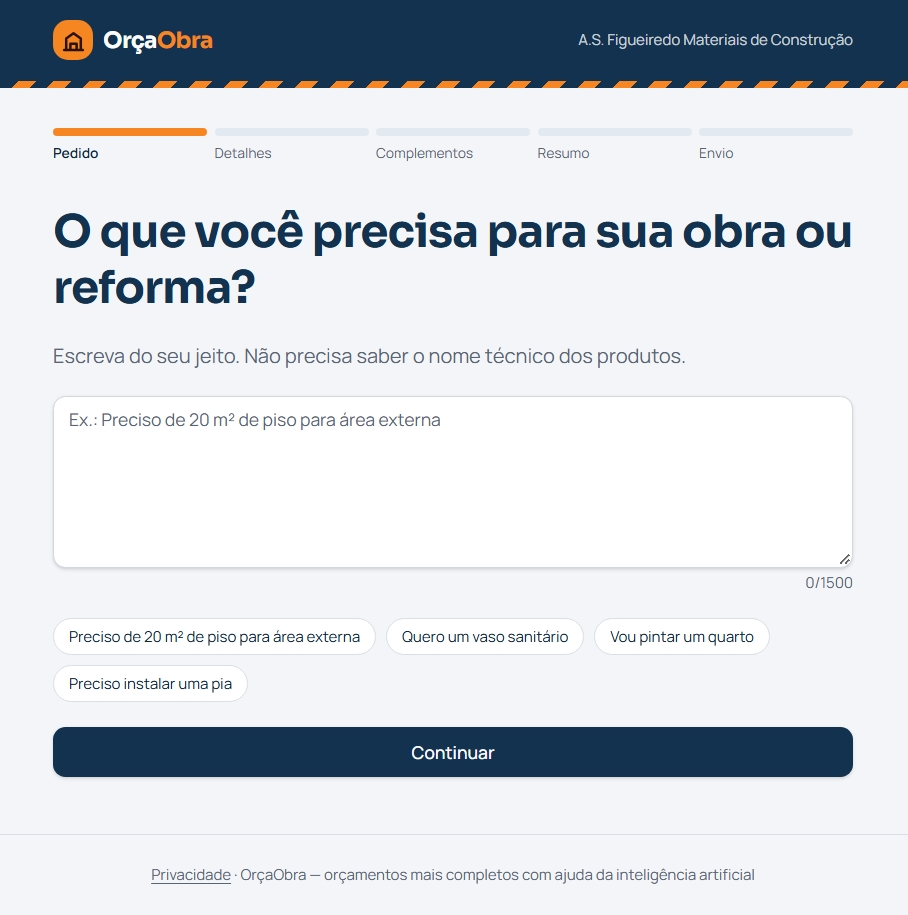
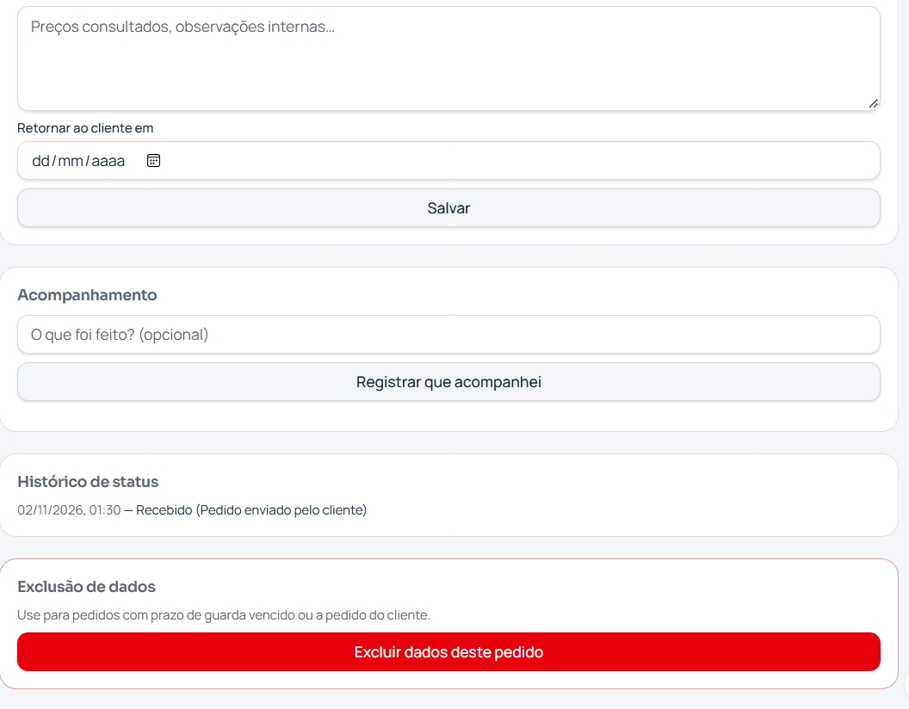

# OrçaObra — orçamento inteligente para lojas de materiais de construção

**Desafio DIO — MeuNegócio.AI: Construindo um Produto Digital com Agentes de IA e Lovable**  
**Autor:** André Santos  
**MVP publicado:** https://orcaobra-br.lovable.app  
**Situação:** versão piloto publicada e testada internamente em 02/11/2026.

> **Importante:** o OrçaObra não vende produtos automaticamente nem emite um orçamento com preços. Ele organiza a *solicitação de orçamento* para a loja, que confirma valores, estoque e condições diretamente com o cliente. O piloto foi desenvolvido para uma única loja; a oferta comercial a outras lojas é uma hipótese futura.

## 1. A dor escolhida e por que existe uma oportunidade de negócio

O projeto nasceu de uma necessidade observada na **A.S. Figueiredo Materiais de Construção**, loja da família no Rio de Janeiro. A operação recebe, em média, **25 pedidos de orçamento por dia**: aproximadamente **15 pelo WhatsApp** e **10 presencialmente**, com variações conforme a demanda.

O problema não é apenas responder mensagens. Muitos consumidores não conhecem o nome técnico dos materiais, fazem pedidos incompletos e deixam dúvidas que exigem várias idas e vindas. Na rotina da equipe, algumas conversas ficam sem acompanhamento, e oportunidades de venda podem ser perdidas.

O **OrçaObra** foi concebido para:

1. transformar uma descrição livre em uma solicitação mais clara;
2. fazer até três perguntas para identificar informações importantes;
3. oferecer materiais complementares relevantes, sempre opcionais;
4. registrar o pedido em um painel único para a equipe da loja;
5. facilitar o retorno por WhatsApp e o acompanhamento de cada solicitação.

A oportunidade de negócio é oferecer esse processo a pequenas lojas de materiais de construção que precisam organizar orçamentos sem substituir imediatamente o sistema de gestão que já utilizam.

## 2. Tamanho de mercado: TAM, SAM e SOM

### Dados de referência

O **Instituto de Pesquisas Anamaco** registrou **160.627 lojas varejistas de materiais de construção no Brasil em 2025**. Destas, cerca de **111.570** eram pequenas lojas, com até quatro funcionários. O levantamento também informa que **97% das lojas pesquisadas vendem pelo WhatsApp**. O faturamento total do varejo do setor foi estimado em **R$ 238,9 bilhões** em 2025. Esses valores representam o setor de materiais de construção, **não** a receita potencial comprovada do OrçaObra.

**Fonte:** [Anamaco — Cenário do Varejo de Material de Construção no Brasil](https://anamaco.com.br/post/estudo-cenario-varejo-material-construcao-brasil/).

Para ilustrar um eventual modelo SaaS, foi adotado um preço **hipotético de R$ 99 por loja/mês**. **Não existe cobrança ativa desse valor no MVP**, nem validação de disposição a pagar. Os cálculos a seguir são cenários, não projeções garantidas.

| Indicador | Critério | Tamanho estimado | Receita anual teórica a R$ 99/mês |
|---|---|---:|---:|
| **TAM** — mercado total | Todas as 160.627 lojas de materiais de construção brasileiras | 160.627 lojas | R$ 190,8 milhões |
| **SAM** — segmento inicialmente compatível | 111.570 pequenas lojas × 97% de uso do WhatsApp, **aproximação** | cerca de 108.223 lojas | R$ 128,6 milhões |
| **SOM** — meta experimental de conquista | Loja piloto mais até **20 lojas pagantes** em um cenário de 12 meses, se houver validação comercial | 1 piloto + até 20 clientes hipotéticos | até R$ 23.760/ano com 20 pagantes |

**Limitações importantes:** a taxa de 97% foi observada em pesquisa setorial, não especificamente no grupo de pequenas lojas; por isso o SAM é uma aproximação. Nem toda loja que usa WhatsApp tem o problema, deseja trocar seu processo ou pagaria por software. O SOM é uma **meta a testar**, e não um resultado realizado. A fase atual atende **uma única loja gratuitamente**.

## 3. Business Model Canvas

| Bloco | Modelo de negócio proposto |
|---|---|
| **Segmentos de clientes** | Pequenas e médias lojas de materiais de construção; primeiro piloto em loja familiar no RJ. |
| **Proposta de valor** | Pedidos de orçamento mais claros; menos retrabalho; complementos sugeridos; acompanhamento centralizado; integração ao atendimento humano existente. |
| **Canais** | Link do OrçaObra compartilhado por WhatsApp, redes sociais, QR Code e balcão da loja. Futuramente, venda direta B2B para outras lojas. |
| **Relacionamento** | Atendimento assistido pela loja via WhatsApp, teste acompanhado no piloto e suporte direto a lojistas em expansão. |
| **Fontes de receita** | No MVP: **nenhuma**, uso gratuito pela loja piloto. Hipótese futura: assinatura mensal por loja; preço ilustrativo de R$ 99/mês. |
| **Recursos principais** | Aplicativo Lovable, IA de interpretação e sugestões, banco Lovable Cloud, regras de complementos revisadas pela equipe, conhecimento dos vendedores. |
| **Atividades principais** | Manutenção do app, ajuste das regras, acompanhamento das métricas de pedidos, atendimento ao lojista, avaliação de custos de IA e segurança. |
| **Parcerias principais** | Loja piloto, Lovable/infraestrutura Cloud, futuros parceiros de divulgação e associações comerciais. |
| **Estrutura de custos** | Plataforma e hospedagem, banco de dados, consumo de IA, suporte, manutenção, eventual aquisição de lojistas. Custos e margens reais ainda precisam ser medidos. |

## 4. Tese do negócio e hipóteses do MVP

**Tese:** se o cliente conseguir descrever sua necessidade com palavras comuns e receber perguntas pertinentes, a equipe receberá pedidos mais completos e poderá responder com menos retrabalho, sem abandonar o WhatsApp nem o sistema de gestão da loja.

Hipóteses e métricas **propostas para o piloto**, ainda não validadas com uma amostra comercial:

| Hipótese | Como testar | Sinal inicial de sucesso proposto |
|---|---|---|
| H1 — O cliente consegue preencher sem conhecimento técnico. | Observar usuários reais completando o pedido pelo celular. | Ao menos 80% concluírem sem ajuda direta. |
| H2 — O pedido chega mais claro ao vendedor. | Comparar pedidos enviados pelo OrçaObra e mensagens tradicionais. | Redução de pelo menos 25% nas perguntas posteriores. |
| H3 — Complementos opcionais geram valor. | Medir aceites de complementos e relevância percebida. | Pelo menos 20% dos pedidos aceitarem uma sugestão pertinente. |
| H4 — O acompanhamento reduz solicitações esquecidas. | Acompanhar status e retornos no painel. | Pelo menos 90% dos pedidos com retorno registrado no período combinado. |
| H5 — Outras lojas pagariam pela solução. | Entrevistas e pilotos externos, após validar o fluxo na loja da família. | Encontrar lojistas dispostos a experimentar e, depois, pagar. |

Esses percentuais são **critérios de validação definidos para futuras medições**, não indicadores já alcançados.

## 5. Fluxo e funcionalidades do MVP

### Área pública — cliente

1. O cliente descreve a obra ou reforma em linguagem natural.
2. A inteligência artificial interpreta a necessidade e pode fazer **até três perguntas**.
3. O sistema apresenta **até cinco sugestões de complementos**, quando há regras pertinentes e revisadas; a escolha é do cliente.
4. O cliente confere o resumo, informa os dados de contato e aceita a política de privacidade.
5. A solicitação é registrada e o cliente recebe um **número de protocolo**.

Se a IA não estiver disponível ou atingir um limite de uso, a intenção do produto é permitir que o pedido prossiga sem análise automática.

### Área administrativa — loja

- Login protegido e perfis de **administrador** e **vendedor**.
- Painel com pedidos, detalhes, status e acompanhamento.
- Consulta às respostas de esclarecimento e aos complementos aceitos.
- Botão para iniciar conversa com o cliente no WhatsApp, com mensagem revisável.
- Regras de complementos sujeitas à revisão humana.
- Registros de testes identificados como tal, para não misturar com as métricas comerciais.

### Decisões de segurança e privacidade

- Separação entre área pública e dados internos, com políticas de acesso por função (RLS).
- Sem listagem pública de solicitações de outros clientes.
- Tratamento dos dados pessoais de contato apenas na etapa de envio da solicitação; os dados de contato não são necessários para a análise de IA.
- Validação de dados e limites antiabuso do serviço de IA.
- Consentimento e página de privacidade.
- Limite mensal de **30 créditos para a categoria de IA** no projeto, configurado no Lovable para controlar despesas durante o piloto. Esse limite diz respeito ao uso do serviço, não a um número garantido de pedidos.

Foi executada uma revisão de segurança antes da publicação. Houve um aviso sobre a natureza pública do interpretador de pedidos: **o recurso precisa aceitar visitantes sem login**. O risco de consumo indevido de IA é mitigado por limites de uso e acompanhamento de consumo; não se afirma risco zero.

## 6. O que ficou manual de propósito

O MVP não integra diretamente o **GdoorPro**, que continua responsável pelo sistema comercial da loja. Permanecem manuais:

- confirmar preços, estoque, prazos e condições no GdoorPro;
- elaborar e enviar a resposta comercial ao cliente pelo WhatsApp Business;
- fechar a venda, receber pagamento e emitir os documentos fiscais no processo habitual;
- revisar e ativar sugestões de materiais complementares;
- cadastrar e autorizar os acessos dos funcionários;
- analisar os resultados do piloto e decidir sobre eventual cobrança recorrente.

**Por quê?** O primeiro objetivo é validar se as solicitações chegam mais completas e se os vendedores conseguem acompanhá-las, sem o custo e o risco de substituir o ERP ou automatizar pagamentos antes de comprovar a demanda.

## 7. Mega prompt consolidado para o Lovable

> **Nota de fidelidade:** abaixo está uma **reconstrução consolidada dos requisitos que orientaram a implementação**. Não é apresentada como transcrição literal da primeira mensagem enviada ao Lovable. O arquivo `docs/plano-implementacao.md` preserva o plano técnico detalhado registrado durante o desenvolvimento.

```markdown
# Produto: OrçaObra — MVP de pedidos de orçamento para materiais de construção

Construa um aplicativo web mobile-first, em português do Brasil,
para uma loja piloto de materiais de construção. A marca usa azul-marinho,
laranja e linguagem acolhedora. O cliente não precisa conhecer nomes técnicos.

## Problema
Muitos pedidos chegam incompletos pelo WhatsApp, exigem esclarecimentos
repetidos e às vezes não são acompanhados pela equipe. O app organiza
as solicitações; não calcula preços nem substitui o ERP.

## Área pública
1. Formulário de texto livre: "O que você precisa para sua obra ou reforma?"
2. IA no servidor interpreta os produtos/atividade e devolve até 3 perguntas.
3. Uma segunda análise usa as respostas e regras revisadas para sugerir
   até 5 complementos opcionais, desmarcados por padrão.
4. Resumo claro, editável, sem preço ou promessas de estoque.
5. Contato (nome/WhatsApp), observação e consentimento de privacidade.
6. Envio seguro com confirmação e protocolo não sequencial.

## Painel administrativo
Login privado, perfis admin/seller, dashboard real, lista e detalhe
de pedidos, status com histórico, anotações, lembretes de retorno,
botão de WhatsApp com mensagem editável e revisão de regras.
Pedidos de teste devem ficar identificados e fora dos indicadores.

## Lovable Cloud
Use banco, autenticação e funções de servidor do Lovable Cloud.
Modele lojas, papéis, solicitações, itens, complementos, regras,
histórico e acompanhamentos. Aplique RLS: público não consulta dados;
vendedores veem o necessário; admins administram regras e acesso.

## IA e proteção
Use IA apenas no servidor. O texto do cliente é dado não confiável.
Valide o JSON produzido e os IDs de complementos autorizados.
Não envie telefone/nome para a IA; mascare contatos no texto.
Não invente preços, disponibilidade, materiais obrigatórios,
quantidades técnicas ou garantias de compatibilidade.
Implemente limites por origem e pedido, teto de uso e fallback sem IA.

## Escopo e entrega
Comece com uma loja única. Não implemente pagamento, marketplace,
API oficial do WhatsApp ou integração ERP neste MVP.
Priorize celular, acessibilidade, privacidade, testes de segurança
e publicação. Não alterar dados reais sem confirmação.
```

## 8. Iterações e correções solicitadas

A aplicação foi construída e refinada por ciclos de especificação, teste e correção. Entre os ajustes discutidos e implementados ou configurados durante a preparação do piloto:

1. **Fluxo de pedido:** separar descrição original, perguntas de esclarecimento, sugestões opcionais, resumo e envio.
2. **Qualidade da IA:** restringir sugestões às regras revisadas, evitando itens inventados e sugestões não pertinentes.
3. **Segurança:** acesso ao painel por papéis, RLS, validações de entrada e proteção contra uso abusivo da IA.
4. **Controle de custo:** regras de limite no servidor e alerta/teto de consumo de IA no projeto Lovable.
5. **Operação comercial:** painel para status, observações internas, retorno e contato por WhatsApp; sem integração com o ERP.
6. **Dados de teste:** identificação dos pedidos fictícios para preservar indicadores.
7. **Publicação:** personalização da URL, remoção do badge de Lovable no plano pago e substituição do favicon padrão pela casinha laranja do OrçaObra.
8. **Responsividade:** checagens no desktop, iPhone e Android.

Os requisitos completos do planejamento estão em [`docs/plano-implementacao.md`](docs/plano-implementacao.md). A lista acima resume a evolução do produto; não simula um log literal de todos os prompts trocados com o Lovable.

## 9. Evidências de teste e funcionamento

**Aplicação publicada:** https://orcaobra-br.lovable.app

Em **02/11/2026**, a versão publicada foi usada em um teste interno completo com pedido fictício para pintura de um quarto. O pedido originou o protocolo **`OO-NP7S-2GPJ`** e chegou ao painel administrativo.

- A IA distinguiu **12 m² de piso** da metragem ainda não informada das paredes.
- Fez perguntas sobre a superfície e os complementos desejados.
- O cliente aceitou **fita crepe** e **lona plástica para proteção**.
- O painel exibiu pedido original, interpretação da IA, perguntas/respostas e materiais aceitos.
- O pedido foi identificado como **TESTE**, não como atendimento comercial real.
- Foram feitas verificações de uso no computador, iPhone e Android.

### Capturas de tela





> Outras telas do painel devem ser capturadas com dados **fictícios ou ocultados** antes de publicação em repositório público. Não divulgar contatos reais de clientes, senhas ou credenciais.

**Estado da validação:** existe um teste interno de ponta a ponta bem-sucedido. A validação com clientes comerciais reais e métricas de conversão ainda faz parte da próxima etapa; não é apresentada como concluída.

## 10. Ferramentas e arquitetura

- **Construção:** Lovable, prompts em linguagem natural e apoio do ChatGPT na especificação e revisão.
- **Frontend:** aplicação web responsiva gerada pelo Lovable.
- **Backend e persistência:** Lovable Cloud, funções de servidor, autenticação e banco de dados com políticas de acesso.
- **IA:** interpretação de solicitação e seleção controlada de complementos.
- **Contato:** link do WhatsApp para atendimento humano.
- **Deploy:** hospedagem da versão publicada pela Lovable.

O repositório público deve conter o **código-fonte real exportado/sincronizado do projeto Lovable**. Este README e as evidências **não substituem o código** exigido pelo desafio.

## 11. Próximos passos de produto

1. Operar o MVP gratuitamente na loja piloto e medir tempo de resposta, completude dos pedidos, taxa de aceite das sugestões e pedidos esquecidos.
2. Ouvir clientes e vendedores; ajustar o fluxo com base em uso real.
3. Convidar funcionários com permissões individuais adequadas.
4. Medir o custo real de IA por solicitação e definir limites sustentáveis.
5. Entrevistar outras lojas antes de decidir o preço e os recursos de uma possível versão SaaS.
6. Avaliar integrações futuras com ERP e WhatsApp oficial somente após comprovar o benefício do fluxo principal.

## 12. Aprendizados

O maior aprendizado do projeto foi que **IA e Vibe Coding aceleram a implementação, mas não substituem o entendimento do negócio**. Conversar com a equipe da loja revelou o problema real: solicitações incompletas e falta de acompanhamento. A partir disso, simplificamos o produto para capturar melhor o pedido e apoiar os vendedores.

Também aprendemos que uma sugestão feita por IA não deve ser automaticamente tratada como verdade. No OrçaObra, regras revisadas por pessoas e validações do servidor são parte da experiência. A revisão de segurança e a definição dos limites de consumo foram essenciais para colocar um fluxo público no ar com responsabilidade.

Por fim, o teste da versão publicada demonstrou que o fluxo completo funciona em um cenário interno. O próximo aprendizado dependerá da utilização por clientes reais e de indicadores observados no dia a dia da loja.

## Checklist para entregar à DIO

- [x] Dor do negócio escolhida e explicada.
- [x] TAM, SAM e SOM apresentados com fontes e hipóteses.
- [x] Business Model Canvas completo.
- [x] Tese, funcionalidades e partes manuais descritas.
- [x] Mega prompt consolidado e principais iterações documentados.
- [x] MVP publicado e teste interno realizado.
- [x] Capturas sem contato real incluídas neste pacote.
- [x] **Sincronizar/exportar o código-fonte do Lovable para repositório GitHub do autor.**
- [ ] Colocar este README, a pasta `docs/` e o código no **mesmo repositório público**.
- [ ] Confirmar que não há chaves secretas, tokens privados ou senhas versionados.
- [ ] Abrir o repositório em navegação anônima e verificar links/imagens.
- [ ] **Enviar à DIO a URL do repositório completo**, não a URL do aplicativo.

**Repositório do projeto:** https://github.com/Sigmabox007/orcaobra-br
